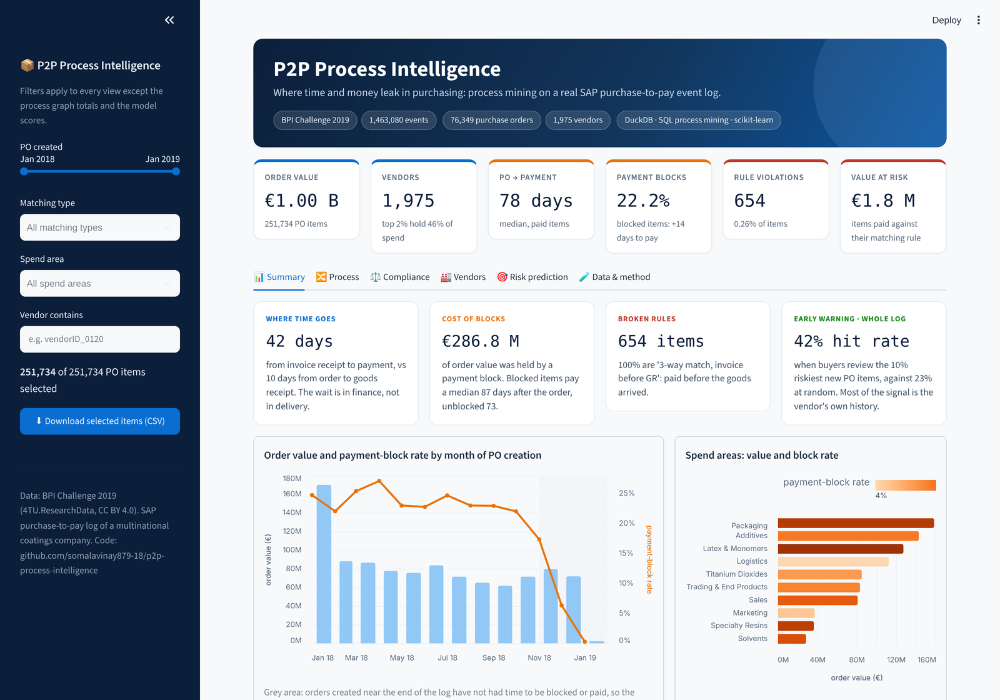
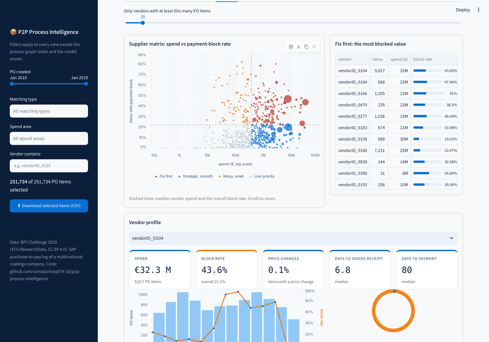
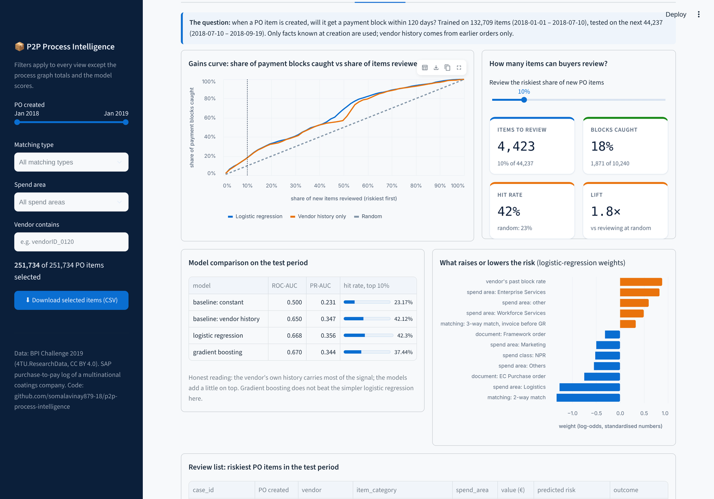
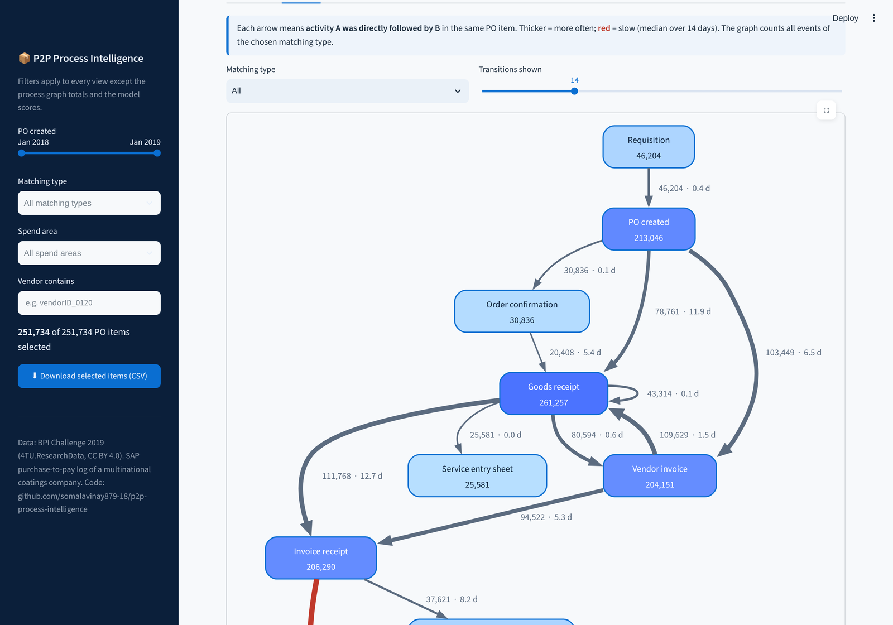

# P2P Process Intelligence

**Where time and money leak in purchasing: process mining on a real SAP purchase-to-pay event log.**

[](https://p2p-process-intelligence.streamlit.app)




The data is the [BPI Challenge 2019](https://data.4tu.nl/articles/dataset/BPI_Challenge_2019/12715853/1) log
(CC BY 4.0): purchase order items from the SAP system of a large multinational coatings and paints company,
with every step from purchase requisition to invoice clearing.

The project answers four questions a purchasing or finance team actually asks:

1. **How does the purchase-to-pay process really run?** Process variants, a directly-follows graph and the
   duration of each step, mined directly in SQL.
2. **Where are the rules broken?** Each PO item has a matching type (3-way match with invoice after or before
   goods receipt, 2-way match, consignment). The analysis checks every item against its own rule and puts a
   euro value on the violations.
3. **Which suppliers cause the friction?** A vendor scorecard: spend, payment blocks, price changes,
   rule violations and time to goods receipt.
4. **Can we see trouble coming?** A model that flags, at PO creation, which items will end up with a payment
   block, evaluated on later orders than it was trained on.

## Results on the full log

251,734 PO items · 76,349 purchase orders · 1,975 vendors · 1.46 M events (after cleaning) · €1,004.9 M order value

| Question | Finding |
|---|---|
| How does the process run? | 11,081 distinct variants, but the top 5 cover 45.5% of items. The most common path (PO → vendor invoice → goods receipt → invoice receipt → clear invoice) is 20.0%. Median PO → payment: **78 days**. |
| Where is time lost? | For "invoice before GR" items, goods arrive after a median 9.8 days, but invoice receipt → payment takes **42.9 days**. The wait is in finance, not in delivery. |
| Where are the rules broken? | 654 items (0.26%) violate their matching rule, all in "3-way, invoice before GR": the invoice was paid before the goods receipt. Value: **€1.75 M**. |
| How costly are payment blocks? | 22.2% of items get a payment block (24.3% for invoice-before-GR, 15.1% for invoice-after-GR). Blocked items take a median **87 days** to pay vs 73 days. |
| Which suppliers matter? | Spend is concentrated: the top 2% of vendors account for 46.3% of spend. The scorecard ranks them by block rate and time to goods receipt. |
| Can blocks be predicted? | See below. |

### Predicting payment blocks at PO creation

Target: payment block within 120 days of PO creation. Trained on items created 2018-01-01 – 2018-07-10
(132,709), tested on the next 44,237 (to 2018-09-19). Block rate in the test period: 23.1%.

| Model | ROC-AUC | PR-AUC | Precision in top 10% |
|---|---|---|---|
| Constant (random ranking) | 0.500 | 0.231 | 23.2% |
| Vendor's past block rate only | 0.650 | 0.347 | 42.1% |
| Logistic regression | **0.668** | **0.356** | **42.3%** |
| Gradient boosting | 0.670 | 0.344 | 37.4% |

**Honest reading:** the vendor's own history carries most of the signal; the models add only a little.
Still, reviewing the 10% riskiest new items finds a block in about 42% of them, against 23% at random.
Two leakage traps were found and fixed on the way: a leave-one-out vendor rate (which leaks the label and made
gradient boosting score *below* random) and right-censoring (recent orders have not had time to be blocked).

## Dashboard

**[Open the live dashboard →](https://p2p-process-intelligence.streamlit.app)** Filter by period, matching type, spend area or vendor; every view updates.

| Supplier matrix and vendor profile | Payment-block risk: gains curve and review list |
|---|---|
|  |  |



## Pipeline

```
BPI_Challenge_2019.xes ──► stream parser ──► DuckDB raw tables ──► SQL staging ──► data-quality checks
                                                                          │
                     dashboard ◄── small aggregate tables ◄── process mining SQL ──► payment-block model
```

| Stage | What it does | File |
|---|---|---|
| Ingestion | Streams the XES file one trace at a time (1.5 M events on a laptop) into Parquet and DuckDB | `p2p/ingest.py` |
| Staging | Typed, cleanly named tables; UTC timestamps; exact duplicates and out-of-period timestamps removed (and counted) | `p2p/sql/staging.sql` |
| Data quality | 7 checks; errors stop the run, warnings are reported in `reports/data_quality.json` | `p2p/quality.py` |
| Process mining | Ordered events (ties broken by P2P step order), case summary, directly-follows graph, variants, step durations | `p2p/sql/process.sql` |
| Compliance | Matching-rule check per item category, value at risk, payment-block rate | `p2p/sql/process.sql` |
| Prediction | Logistic regression and gradient boosting vs two baselines, time-based split, vendor history from the training period only | `p2p/model.py` |
| Dashboard | Streamlit with sidebar filters (period, matching type, spend area, vendor): summary, process map, compliance with downloadable violation list, supplier matrix and vendor profiles, risk review list with a gains curve, data quality | `app.py` |

## Run it

```bash
make setup          # virtual environment + pinned dependencies
make demo           # whole pipeline on a small synthetic log (no download)
make app            # dashboard on http://localhost:8501
```

For the real results, download `BPI_Challenge_2019.xes` from
[4TU.ResearchData](https://data.4tu.nl/articles/dataset/BPI_Challenge_2019/12715853/1) into `data/raw/`, then:

```bash
make run            # a few minutes
make app
```

Tests: `make test`. They run the full pipeline on a synthetic log in the same XES format, with planted
rule violations, payment blocks and data-quality problems, so every expected number is known in advance.

## Limitations

- The log has no payment terms, so lost cash discounts cannot be measured.
- "Cumulative net worth" is used as the item value; it reflects the value recorded on each event.
- 132,748 exact duplicate events and 95 events dated outside 2017–2020 were removed (see the Data quality tab).
- In this log a payment block is mostly set automatically and only its removal is recorded, so "Set Payment
  Block" or "Remove Payment Block" both count as a block.
- The log ends in early 2019: the last months show fewer blocks and payments only because those orders are
  still open. The model leaves out orders created in the last 120 days for this reason.
- Matching rules are checked from event order; an SAP system may allow approved exceptions that the log does
  not show.
